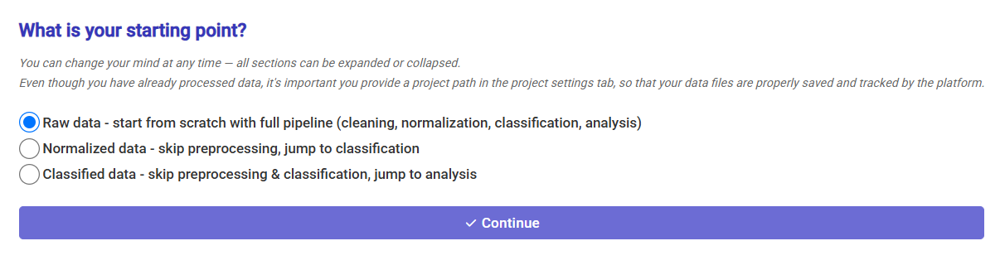

Configure the project and import data
=====================================

**Input:** the directory prepared in :doc:`tma`.

Select the working directory
----------------------------

1. Launch SCORPy and open **Project Settings**.
2. Select ``ctTMA_project`` as the working directory.
3. Check that the expected output directories are created.

.. admonition:: Make sure `data` and `metadata` directories are present, even if empty.

   If you ever modify the content of these directories, press again `Validate structure` to apply the changes. 
   You will have to repeat some steps of your analysis if you modified the content of these directories.

.. video:: ../../../resources/ctTMA_Projet_settings.mp4
   :width: 100%
   :align: center

Select your starting point
--------------------------------

Once you open the **Input Files** tab, you can select your starting point for the analysis in the pop up window.
Here, our starting point is the raw data table that contains the measurements for each mouse sample and ROI.

.. admonition:: Note

   The starting point pop up window will be displayed once, when you first open the **Input Files** tab.
   You can change the starting point later by reopening the **Input Files** tab and directly selecting 
   a different merging / processing option from the tab.

Merge and/or process the raw data
--------------------------------

1. Select your raw file from the list.
2. Click **Merge/Process** to process your file.
3. Open the **Data Preview** sub-section to inspect the processed raw data and confirm that the processed data looks correct before proceeding.
4. (Optional) You can also open the saved CSVfile in the `init/` directory to inspect its content.

.. video:: ../../../resources/ctTMA_Input_files1.mp4
   :width: 100%
   :align: center

Attach metadata
---------------

1. Load ``metadata/ctTMA.ome.tif.csv`` as exposure metadata and inspect how
   its entries map to marker and autofluorescence measurements. 
   Make sure columns names match between the metadata and the raw data.
2. Load ``metadata/ctTMA_annotations.csv`` as annotations. 
   Make sure the `Sample_ID` and `ROI_index` columns exist and correctly match your raw data.

.. csv-table:: ctTMA exposure time file
   :file: ../_static/ctTMA.ome.tif.csv
   :header-rows: 1
   :widths: auto
   

.. admonition:: Note

   Only the `ChannelIndex`, `ExposureTime`, `Cycle` and `Name` columns are required in the exposure metadata file.

.. csv-table:: ctTMA annotations file
   :file: ../_static/ctTMA_annotations.csv
   :header-rows: 1
   :widths: auto

.. admonition:: Note

   Make sure the `Sample_ID` and `ROI_index` columns name and content correctly match the your raw data. 
   Otherwise, the join between the raw data and annotations will fail.
   If you work with whole tissue slides (or one ROI per slide), the `ROI_index` column is still required 
   but you can fill this column with a default value, such as `0` or `1`.

.. video:: ../../../resources/ctTMA_Input_files2.mp4
   :width: 100%
   :align: center

**Next:** :doc:`preprocessing`. For input conventions, see :doc:`../settings`.
