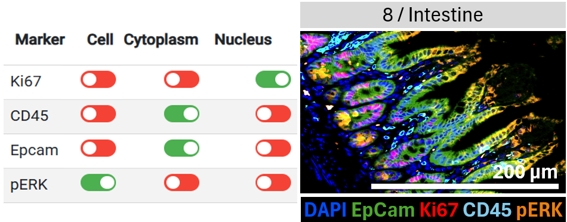
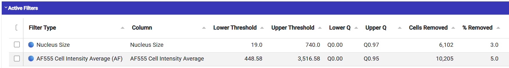
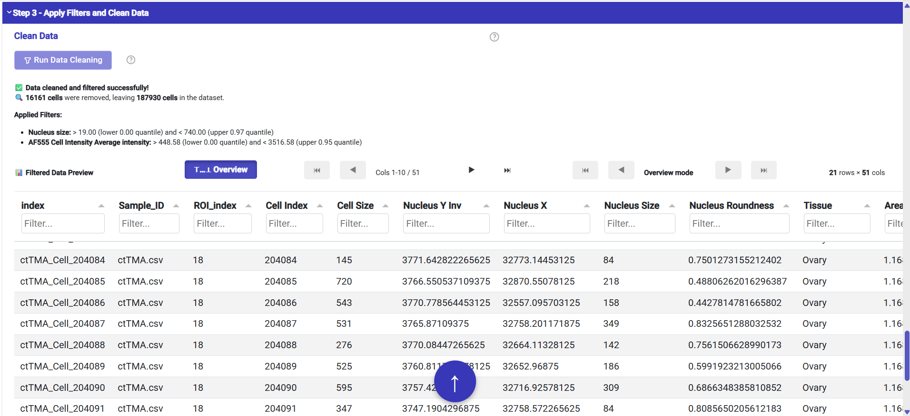

Clean and normalize the ctTMA data
================================================

**Input:** the raw table and metadata loaded in :doc:`import`.

Select protein localization of interest
------------------------------------

   Exemple with Intestine tissue (ROI number 8) and 4 markers with different subcellular localizations.

Filter cells to remove residual segmentation artefacts and autofluorescent cells
------------------------------------

Adjust your desired filter thresholds based on the inspected distributions and check the applied/active filters.

.. video:: ../../../resources/ctTMA_Cleaning1.mp4
   :width: 100%
   :align: center

   Screenshot showing the applied filters and their effect on the cell distributions.

Then, click on `Run Data Cleaning` to apply the filters and remove unwanted cells before proceeding to **Normalization** tab.

   :width: 100%
   :align: center

Correct background and normalize
---------------------------------

Once the data cleaning is complete, proceed to the **Normalization** tab. 
First, remove any remaining background signal by applying the background correction (optionnal), 
and then normalize the data to ensure comparability across samples (also optionnal but highly recommended).

.. video:: ../../../resources/ctTMA_Normalization.mp4
   :width: 100%
   :align: center

The applied normalization is a modified z-score, centered around the median of each marker across all cells.

.. admonition:: Note

   Because we use a ctTMA, we do not need to use a reference to normalize the data, 
   so we can skip this step and normalization is done based on the ctTMA itself.

You can save your normalized and cleaned data at this stage in the saving sub-sections.

Check before continuing
-----------------------

Record marker selections, filter thresholds, correction settings, and output
location, if you wish to reproduce the analysis later.

**Next:** :doc:`classification`.
