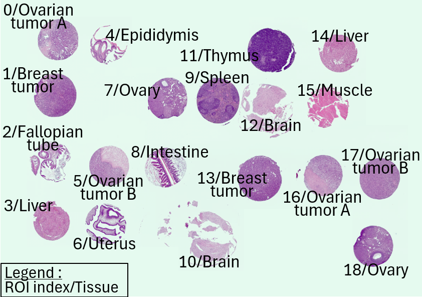
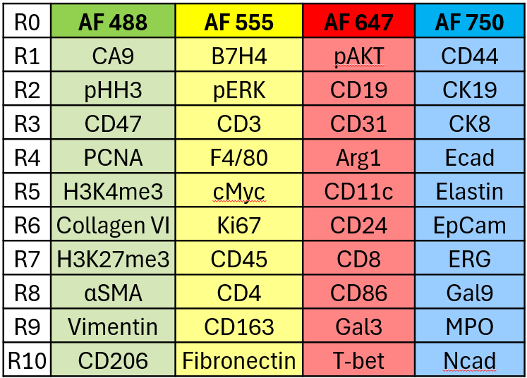
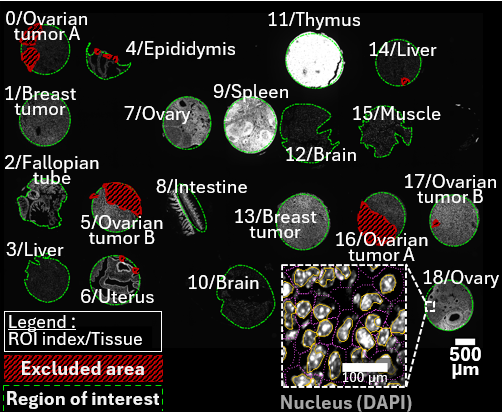

Download and prepare the ctTMA dataset
================================================

This tutorial follows the control tissue microarray (ctTMA) dataset published
with SCORPy. Unlike the User guide, which explains individual features, this
section takes you through a single analysis from downloaded files to results.

We constructed a reference control TMA (ctTMA) composed of a diverse set of murine 
normal and cancer tissues. The dataset comprising **40 proteins** measured across the **19 TMA tissue cores**. 
Each ctTMA core was defined as a region of interest (ROI). Following image acquisition and registration, cell segmentation 
was conducted. Tissue folds and other technical artefacts, including regions affected by uneven or inconsistent staining,
were excluded from pre-segmentation. 
Segmentation generated a raw single‑cell dataset comprising a total of **204,091** cells with per cell autofluorescence 
and marker intensities, spatial coordinates, and associated metadata. 

The reference control TMA (ctTMA)
--------------------------

    
    ctTMA Hematoxylin & Eosin staining and ROI/tissue identification

    
    ctTMA Antibody Panel

    
    Segmentation mask (QiTissue software)

Download the example input files
--------------------------

Open `Zenodo record 22096493 <https://zenodo.org/records/22096493>`_ and
download the following files individually:

.. list-table::
   :header-rows: 1
   :widths: 35 65

   * - File
     - Use in this tutorial
   * - ``ctTMA_raw.csv``
     - Starting single-cell table (407.3 MB).
   * - ``ctTMA.ome.tif.csv``
     - Accompanying exposure metadata (5.0 kB).
   * - ``ctTMA_annotations.csv``
     - Tissue/sample/ROI annotations (1.0 kB).
   * - ``ctTMA_cell_tree.json``
     - Provided phenotype library (11.6 kB).
   * - ``ctTMA_classified.csv``
     - Provided classified dataset for a downstream-only route (107.2 MB).

.. important::

   The record also includes ``ctTMA.ome.tif`` (86.9 GB). You do not need to
   download this image to import the single-cell table or run SCORPy. Nonetheless,
   it is useful for comparison with the original fluorescence signal when an appropriate OME TIFF image
   viewer is available.

.. image:: ../../../resources/get_started.png

Create a working directory
--------------------------

Keep the original downloads unchanged and arrange working copies as follows:

.. code-block:: text

   ctTMA_project/
     data/
       ctTMA_raw.csv
     metadata/
       ctTMA.ome.tif.csv
       ctTMA_annotations.csv
     figures/
       ctTMA_cell_tree.json
       ctTMA_classified.csv

The ``figures/`` folder is a tutorial organizational choice, not a required
SCORPy directory at the start. Do not merge the raw and classified tables: they are
alternative processing stages of the example.

Choose a route
--------------

* **Full workflow:** use ``ctTMA_raw.csv`` and continue with :doc:`import`.
* **Downstream-only workflow:** load ``ctTMA_classified.csv`` as the active
  dataset (already normalized and classified), inspect its identifiers and labels, then start with :doc:`analysis`.
  Do not repeat normalization on this table.

