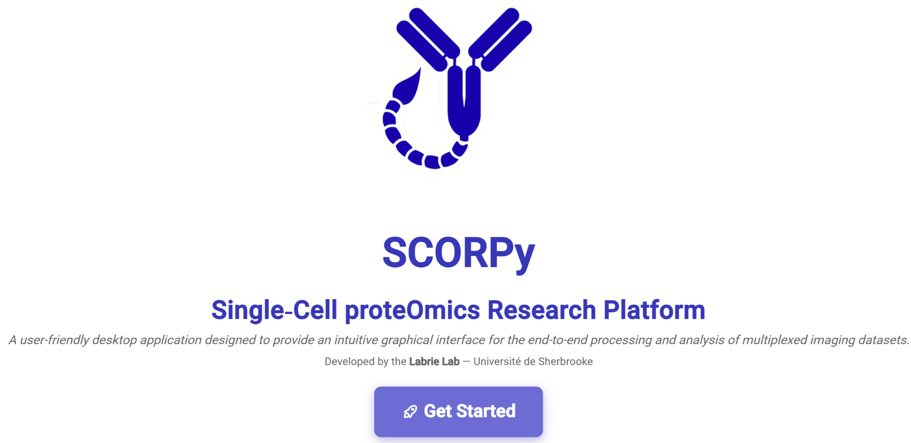

Download and prepare the ctTMA dataset
================================================

This tutorial follows the control tissue microarray (ctTMA) dataset published
with SCORPy. Unlike the User guide, which explains individual features, this
section takes you through a single analysis from downloaded files to results.

Download the example files
--------------------------

Open `Zenodo record 22096493 <https://zenodo.org/records/22096493>`_ and
download the following files individually:

.. list-table::
   :header-rows: 1
   :widths: 35 65

   * - File
     - Use in this tutorial
   * - ``ctTMA_raw.csv``
     - Starting single-cell table (407.3 MB).
   * - ``ctTMA.ome.tif.csv``
     - Accompanying exposure metadata (5.0 kB).
   * - ``ctTMA_annotations.csv``
     - Tissue/sample/ROI annotations (1.0 kB).
   * - ``ctTMA_cell_tree.json``
     - Provided phenotype library (11.6 kB).
   * - ``ctTMA_classified.csv``
     - Provided classified dataset for a downstream-only route (107.2 MB).

.. important::

   The record also includes ``ctTMA.ome.tif`` (86.9 GB). You do not need to
   download this image to import the single-cell table or run SCORPy. Nonetheless,
   it is useful for comparison with the original fluorescence signal when an appropriate OME TIFF image
   viewer is available.

Create a working directory
--------------------------

Keep the original downloads unchanged and arrange working copies as follows:

.. code-block:: text

   ctTMA_project/
     data/
       ctTMA_raw.csv
     metadata/
       ctTMA.ome.tif.csv
       ctTMA_annotations.csv
     figures/
       ctTMA_cell_tree.json
       ctTMA_classified.csv

The ``figures/`` folder is a tutorial organizational choice, not a required
SCORPy directory at the start. Do not merge the raw and classified tables: they are
alternative processing stages of the example.

.. admonition:: Screenshot to add

   Show the Zenodo file list and the prepared project directory. Keep
   filenames visible, but hide personal paths.

Choose a route
--------------

* **Full workflow:** use ``ctTMA_raw.csv`` and continue with :doc:`import`.
* **Downstream-only workflow:** load ``ctTMA_classified.csv`` as the active
  dataset (already normalized and classified), inspect its identifiers and labels, then start with :doc:`analysis`.
  Do not repeat normalization on this table.

