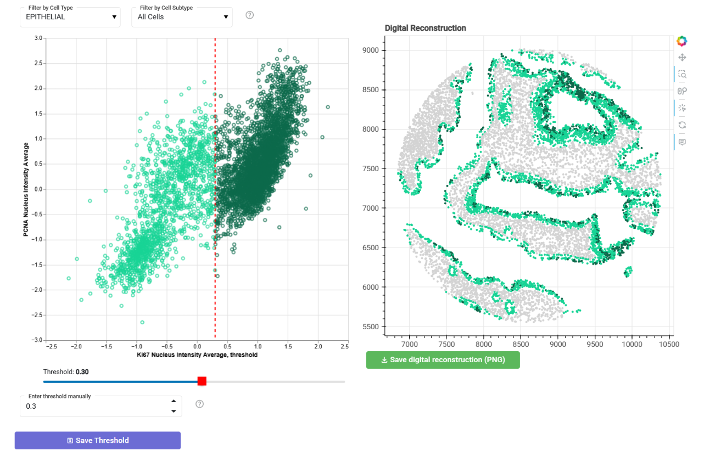
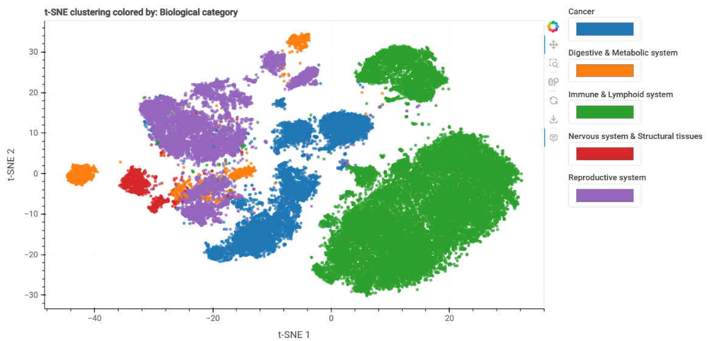

Marker analysis and quantification
==================================

Explore marker expression
-------------------------

Use **Marker Analysis** to inspect marker measurements within selected
cell types or subtypes.

Generate binary marker variables
--------------------------------

Define marker positivity using a threshold and, when needed, a cell-type
constraint. Example: define **Ki67 positivity** only within the immune cell compartment.

    Example showing Ki67-positive cells within the epithelial cell compartment of a TMA core. 
    Selected threshold = 0.30

These variables can describe functional states within a population and
can be used in spatial grid rules or exported for other analyses.
Keep the threshold and population definition alongside the derived column.

Protein expressions across tissue
----------------------------

You can also visualize marker expression in the spatial context of the tissue. 
This can help readjust thresholds, validate phenotypes, or interpret spatial patterns.

.. figure:: ../../resources/example_ki67_epithelial_cells_in_space.png
    :alt: Example of Ki67-positive epithelial cells in spatial context

    Example showing Ki67 expression in epithelial cells in the spatial context of a TMA core.

Tissue area and cell density
----------------------------

Two area sources are available: an existing area measurement (your own measurement),
with unit conversion, or SCORPy can estimate from the occupied spatial distribution
of cell centroids (based in pixels, converted to physical units using imaging resolution).

Check area units and imaging resolution before computing densities:

.. math::

   \mathrm{density} = \frac{\mathrm{cell\ count}}{\mathrm{tissue\ area}}

An area inferred from cell positions is an estimate, not a segmentation mask.
Its value depends on spatial binning and cell coverage; inspect it for
sparse tissue, holes, and disconnected regions.

You can now compute cell densities or proportions analysis,using the inferred or measured tissue area in the **Quantification** tab.

UMAP and t-SNE
--------------

Choose the markers, cells, and embedding method. 
Record sampling size,random state, and method-specific parameters when available. 
Compare embeddings colored by phenotype, sample, and experimental group.

UMAP and t-SNE are dimensionality-reduction visualizations, not cell-type
classification or clustering algorithms. Separation in an embedding alone
does not validate a phenotype or establish a biological difference.

    Example showing a t-SNE embedding of cells colored by biological tissue type.

**Next:** :doc:`spatial`.
