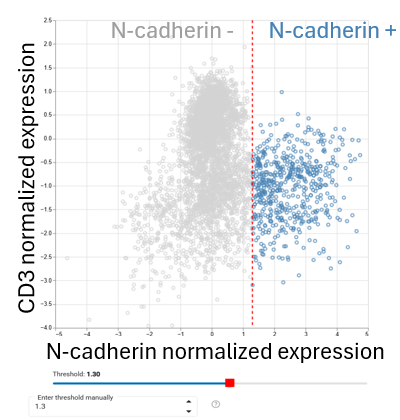
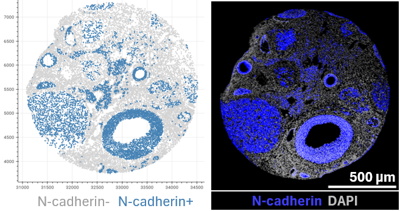
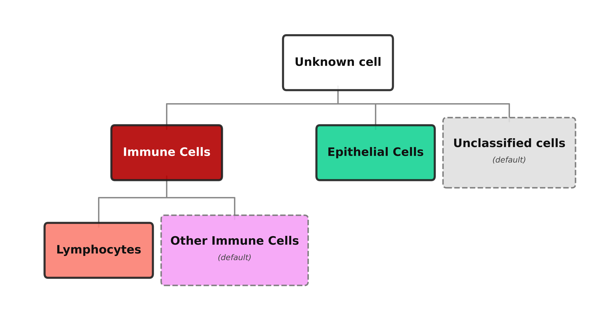

Thresholds and cell phenotyping
===============================

Define marker positivity
------------------------

Load the dataset at the intended processing stage and open **Thresholds**.
Use bivariate expression plots to examine separation between marker-positive
and marker-negative populations, comparing **mutually exclusive markers** where
biologically appropriate (example CD3 and N-cadherin markers expected to be mutually exclusive).

Adjust each threshold while checking the highlighted cells. 

    Scatterplot showing N-cadherin expression (x axis) and CD3 expression (y axis) 
    in the ctTMA dataset. 
    Red horizontal line indicates the N-cadherin threshold applied.
    Selected threshold = 1.30

Validate in tissue context
--------------------------

Inspect marker-positive cells in the digital tissue reconstruction for
individual samples and ROIs. Compare their locations with the original
fluorescence images when available.

    Digital reconstruction showing N-cadherin-positive cells in the ctTMA dataset (left) and 
    its real expression in the tissue (right). (Selected threshold = 1.30, see :doc:`classification` section 5.1)

Build a phenotype library
-------------------------

In **Cell Classification**, build a hierarchical decision tree. Begin with
major compartments, then add subtypes using marker combinations.

For example, an immune compartment can be defined using CD45 and then
subdivided using lineage markers. These are dataset-specific biological
rules, not universal phenotype definitions.

Review the classification on expression plots and tissue reconstructions,
including cells assigned to default populations.

Rule logic, priority, and defaults
----------------------------------

When a phenotype rule includes multiple markers, 
SCORPy evaluates them using AND or OR logic (OR is the default). 

For example, **immune cells** may be defined as CD3⁺ **OR** CD45⁺ cells, 
while **regulatory T cells** may be defined as CD4⁺ **AND** FOXP3⁺ cells.
Rules are traversed depth-first and left-to-right. 

Among sibling rules, the first match takes priority. 
Cells that match no rule receive the configured default label. 
A default label is required to ensure that all cells are assigned a phenotype at each branch.

Because overlapping rules can yield different assignments when reordered, 
explicitly check sibling-rule priority, default labels, and ambiguous marker combinations. 

.. note::
    Example below illustrates a simple hierarchical phenotype tree.
    Root-level classes represent **cell types** (Immune cells, Epithelial cells and Unclassified cells); 
    deeper levels refine them into **cell subtypes** (Lymphocytes, Other immune cells, Epithelial cells and Unclassified cells).

Heatmaps
--------------------------

Visualize marker expression and phenotype assignments using heatmaps. 
These can help identify patterns, validate classification rules, 
and detect potential issues with marker thresholds, background correction, or rule logic.

Save and reuse definitions
--------------------------

Export thresholds and the phenotype tree, retaining them with the classified
dataset and application version. Thresholds are saved in CSV
format and classification trees in JSON format.

**Next:** :doc:`analysis`.
