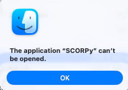

Getting started
===============

Download and launch
-------------------

Download the application in a matter of seconds for your operating system from the
`official releases <https://github.com/marylab26/SCORPy/releases>`_ page.

.. button-link:: https://github.com/marylab26/SCORPy/releases
    :color: danger
    :shadow:
    :align: center

    Download SCORPy software

Then, depending on your operating system:   
    * **Windows:** launch ``SCORPy.exe``.
    * **macOS:** launch ``SCORPy.app``.

The pre-built application does not require a separate Python installation.
Keep the release version with your analysis records, on your desktop or anywhere you would store a software application.

On macOS, if the application is blocked, you can use the following commands.
Run them in Terminal from the directory containing ``SCORPy.app``:

.. code-block:: bash

   chmod +x SCORPy.app/Contents/MacOS/SCORPy
   xattr -dr com.apple.quarantine SCORPy.app

.. warning::

   Removing quarantine attributes bypasses a macOS protection. Only do this
   for an application downloaded from the official repository that you trust.

Prepare a project
-----------------

Create a working directory containing ``data`` and ``metadata`` subfolders.
They may initially be empty. Use **Project Settings** to select the working
directory, then **Input Files** to load your tables. See :doc:`settings` for
the expected structure and import checks.

Keep original input files unchanged so that filtering and normalization can
be repeated.

Choose your starting point
--------------------------

* **Raw post-segmentation tables:** start with **Input Files**, then
  **Cleaning** and **Normalization**.
* **Already normalized data:** proceed to **Thresholds** or
  **Cell Classification** after loading the dataset.
* **Already classified data:** proceed to **Marker Analysis**,
  **Quantification**, or spatial analysis after loading the dataset.

Do not normalize already normalized data again without a methodological
reason. Imported downstream datasets must still provide the identifiers,
marker measurements, classification labels, or spatial coordinates needed
by the selected analysis.
